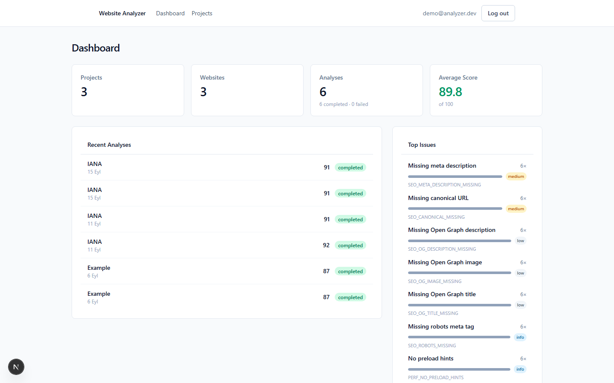
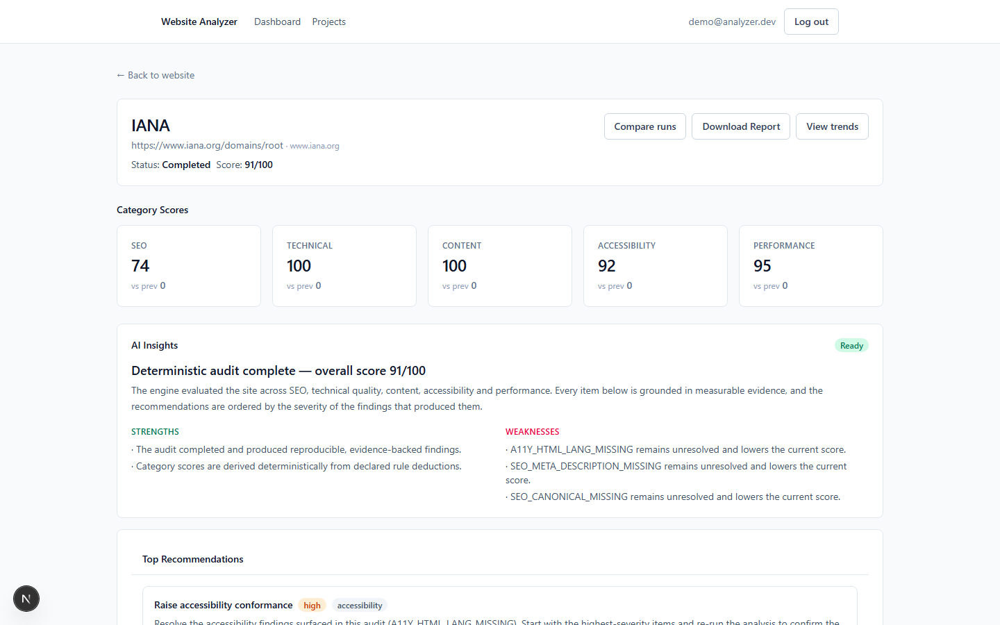
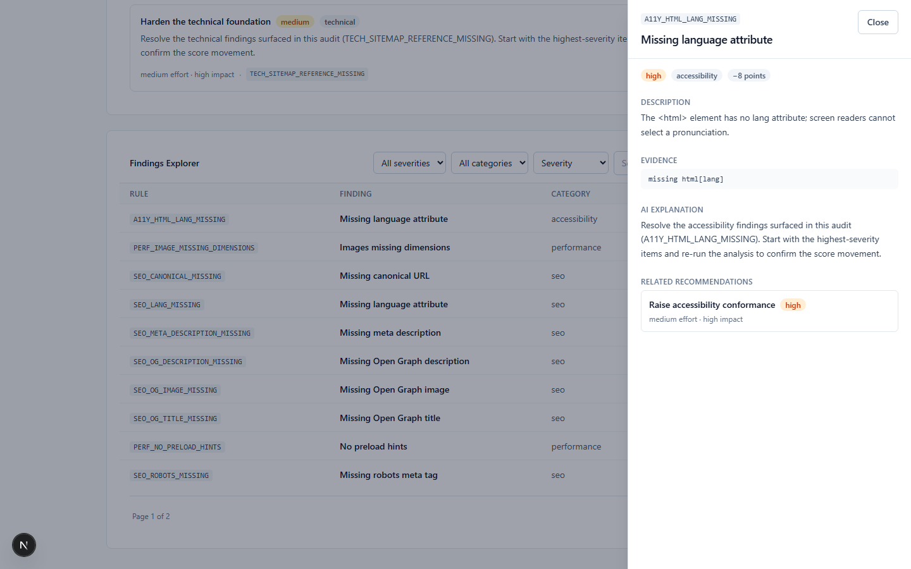
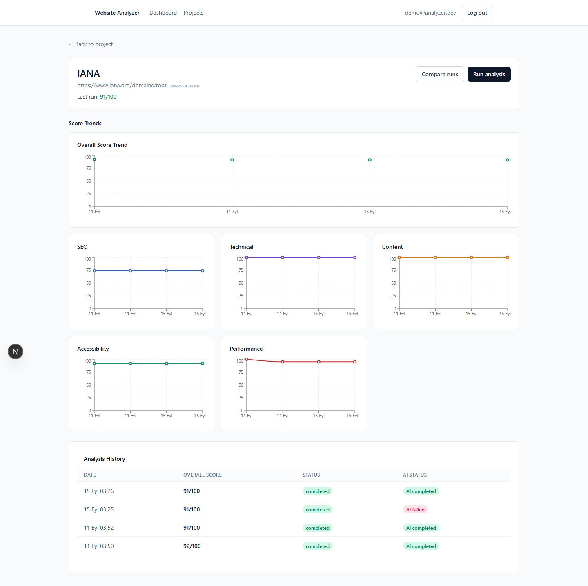
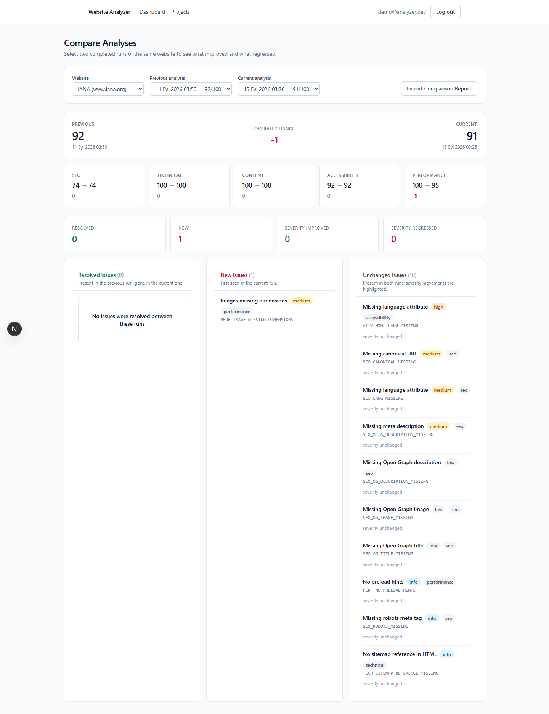
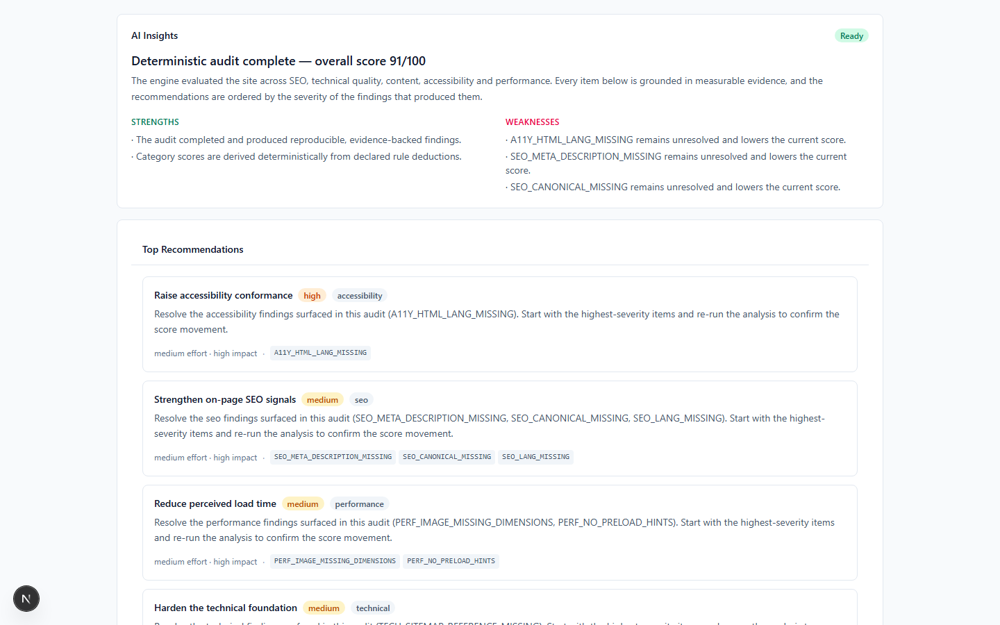
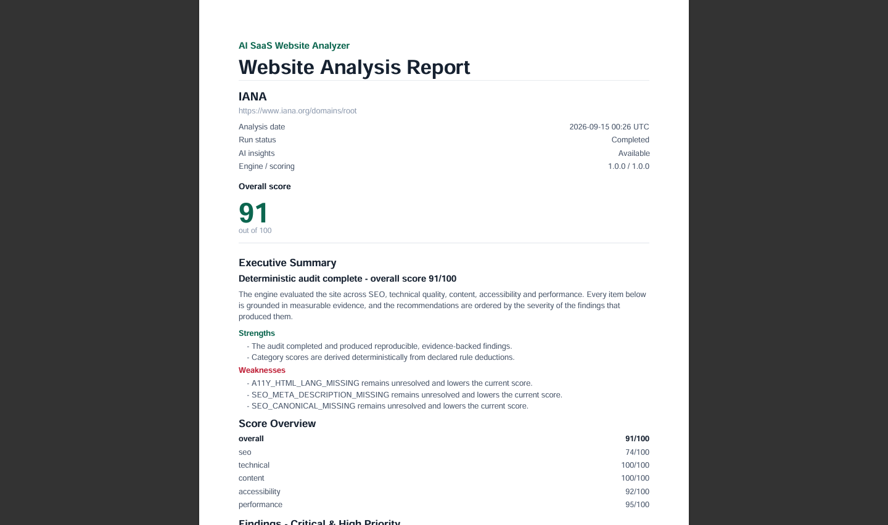
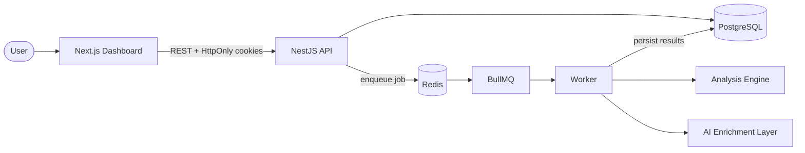

<div align="center">

# AI SaaS Website Analyzer

**A full-stack platform that audits websites across technical quality, SEO, accessibility, content quality and performance — producing deterministic, reproducible results and grounded AI recommendations on top of them.**

[](.nvmrc)
[](tsconfig.base.json)
[](docs/deployment/local-development.md#testing)
[](.github/workflows/ci.yml)
[](LICENSE)

</div>

---

## Key Features

### Website Analysis

- **Deterministic analysis engine** — fetches a target, normalizes the HTML once, and runs every rule over that single document.
- **56 rule checks** across five categories: SEO, technical, content, accessibility and performance.
- **Category scoring** — each category starts at 100 and deducts declared point values; the overall score is a versioned weight average.
- **Historical tracking** — every run is persisted, so score trends and per-category history are available per website.

### AI Recommendations

- **Grounded recommendations** — the model may only reference finding codes that actually exist in the run; unknown codes, category mismatches and over-referencing are rejected.
- **Structured outputs** — validated against a schema, then against domain rules and evidence.
- **Provider abstraction** — the application depends on a single provider interface; the implemented adapter speaks an OpenAI-compatible API with no vendor SDK.
- **Recommendation validation** — invalid output gets at most one bounded repair attempt, then fails safely without affecting the deterministic result.

### Platform

- **Authentication** — cookie-based sessions with short-lived access tokens and rotating refresh tokens; passwords hashed with Argon2.
- **Projects and website management** — organize monitored targets under projects, deduplicated per project.
- **Dashboards** — overview stats, recent analyses, most frequent issues, activity feed and per-website score trends.
- **Findings explorer** — filter by severity and category, search, sort and paginate, with a finding detail drawer showing evidence.
- **Comparison** — diff any two completed runs of the same website: score deltas, and new / resolved / unchanged findings with severity transitions.
- **Reporting and PDF export** — a framework-independent report document model rendered server-side to PDF.

### Reliability

- **Async processing** — analyses and AI enrichment run on a separate worker over two queues; HTTP requests never block on external work.
- **Retry handling** — transient failures retry with exponential backoff; permanent failures fail fast and are classified.
- **Idempotency** — deterministic job ids plus unique constraints mean a redelivered job can never duplicate results.
- **Stale recovery** — interrupted runs are detected and finalized after a configurable threshold.

### Security

- **SSRF protection** — scheme, credential, hostname and address-range validation at every hop, including redirects and DNS resolution.
- **CSRF protection** — `SameSite` cookies, JSON-only bodies, an explicit CORS origin allowlist and an origin/referer guard on state-changing requests.
- **Ownership isolation** — every resource is scoped to its owner; a foreign identifier returns `404`, never `403`.
- **Rate limiting** — Redis-backed, shared across instances, with dedicated budgets for auth and analysis creation.

---

## Screenshots

Captured from the running application; conventions and the capture plan live in
[`docs/screenshots/`](docs/screenshots/README.md).

**Dashboard** — overview, recent analyses, top issues and activity.



**Analysis details** — overall and per-category scores with deltas against the previous run.



**Findings explorer** — severity/category filters, search, pagination and the evidence drawer.



**Historical trends** — score history across analyses of a website.



**Analysis comparison** — score and finding changes between two completed runs.



**AI recommendations** — grounded, prioritized recommendations on top of the deterministic result.



**Report export** — the generated PDF report.



---

## System Architecture

Details: [`docs/architecture/system-overview.md`](docs/architecture/system-overview.md)



The system is a **modular monolith with a dedicated worker**. The Next.js
dashboard talks to a NestJS API over credentialed HTTP. Anything slow or
external — fetching a website, calling an AI provider — is never done inside an
HTTP request: the API records intent in PostgreSQL, enqueues a BullMQ job that
carries only identifier references, and returns. A separate worker consumes the
job, runs the deterministic engine, persists findings and scores, then enqueues
AI enrichment. PostgreSQL is the source of truth; Redis carries work, never state.

---

## Analysis Pipeline

Details: [`docs/architecture/analysis-pipeline.md`](docs/architecture/analysis-pipeline.md)

1. **URL submission** — `POST /api/v1/analyses` creates the analysis and its first run.
2. **Validation** — request shape at the API boundary, URL structure in the engine.
3. **SSRF protection** — scheme, credentials, hostname and every resolved address are validated before any connection.
4. **Fetching** — bounded by configuration: connection and total timeouts, redirect cap and response size.
5. **HTML normalization** — parsed once into a single document every analyzer consumes.
6. **Rule execution** — five analyzers run in isolation; one failure yields a partially completed run, not a discarded one.
7. **Scoring** — deterministic deductions and a versioned weighted overall score.
8. **Persistence** — findings and score snapshots are written in one transaction.
9. **AI enrichment** — runs after the deterministic result is committed, on its own queue.

> Deterministic analysis is the source of truth. AI explains, prioritizes and
> enriches it — it never computes scores or invents findings.

---

## Repository Structure

```text
apps/
├── web/           Next.js dashboard (App Router, Tailwind CSS)
├── api/           NestJS REST API, Swagger, health probes, report endpoints
└── worker/        BullMQ worker (analyses + AI enrichment)

packages/
├── shared/        Framework-independent utilities and primitives
├── contracts/     Typed API request/response contracts
├── config/        Centralized environment schema and validation
├── analysis/      Deterministic analysis engine and run comparison
├── ai/            Provider-independent AI orchestration
└── report/        Report document model and server-side PDF renderer

docs/
├── architecture/  How the system is built
├── decisions/     Why it is built that way
├── deployment/    Local and production operation
└── screenshots/   Captured UI screenshots

infrastructure/    Docker Compose for PostgreSQL and Redis
.github/           CI workflow
```

---

## Technology Stack

| Area | Technologies |
| --- | --- |
| **Frontend** | Next.js (App Router), React, TypeScript, Tailwind CSS, TanStack Query, TanStack Table, Recharts, React Hook Form, Zod |
| **Backend** | NestJS, TypeScript, REST, Swagger/OpenAPI, Prisma, Zod-validated configuration |
| **Database** | PostgreSQL 16 |
| **Queue** | Redis 7 with BullMQ, consumed by a dedicated worker process |
| **Security** | Argon2 (passwords), JWT access tokens, rotating opaque refresh tokens, Redis-backed rate limiting, security headers |
| **Reporting** | pdf-lib for server-side, deterministic PDF rendering |
| **Infrastructure** | Docker multi-stage images, Docker Compose, GitHub Actions |
| **Testing** | Vitest, Supertest (API integration), Testing Library (components) |
| **Tooling** | pnpm workspaces, Turborepo, ESLint, Prettier, TypeScript strict mode |

---

## Security Highlights

Details: [`docs/decisions/ssrf-protection.md`](docs/decisions/ssrf-protection.md) ·
[`docs/decisions/auth-design.md`](docs/decisions/auth-design.md)

- **SSRF defenses** — only `http`/`https`, no URL credentials, blocked internal and metadata hostnames, and every resolved address checked against loopback, private, link-local, CGNAT, reserved, multicast, documentation, NAT64 and IPv4-mapped ranges. IPv6 is expanded to hextets so hex-form IPv4-mapped addresses cannot slip through, DNS answers are validated both before and during connection, and every redirect hop is re-validated.
- **Token rotation** — short-lived access tokens with opaque refresh tokens that are rotated on use; only a SHA-256 hash of the refresh token is stored, the raw value lives solely in an `HttpOnly` cookie.
- **Redis rate limiting** — shared across instances with separate budgets for general traffic, authentication and analysis creation; `429` responses carry `Retry-After`, and the auth budget always fails closed.
- **Secure cookies** — `HttpOnly`, `SameSite=Lax`, and `Secure` in production, paired with an explicit CORS allowlist and a state-changing-request origin guard.
- **Production guards** — the API refuses to start with development JWT secrets, and never leaks stack traces, connection strings or secrets in responses or logs.

---

## Documentation

| Section | Contents |
| --- | --- |
| [Architecture](docs/architecture/README.md) | System overview, analysis pipeline, queue architecture, AI enrichment flow, database design |
| [Decisions](docs/decisions/README.md) | Authentication, queue, SSRF, analysis engine and AI orchestration decision records |
| [Deployment](docs/deployment/README.md) | Local development and production deployment guides |
| [Screenshots](docs/screenshots/README.md) | Captured UI screenshots and capture conventions |

---

## Local Development

Full guide: [`docs/deployment/local-development.md`](docs/deployment/local-development.md)

**Prerequisites:** Node.js ≥ 20.19, pnpm 11 (`corepack enable`), Docker with Compose.

```bash
pnpm install                 # install all workspace packages
cp .env.example .env         # development-safe defaults
pnpm db:up                   # PostgreSQL + Redis via Docker Compose
pnpm dev                     # web, api and worker in watch mode
```

- Web dashboard: <http://localhost:3000>
- API health: <http://localhost:4000/health> · Readiness: <http://localhost:4000/health/ready>
- API docs (Swagger): <http://localhost:4000/api/v1/docs>

Optional demo data: `pnpm --filter @analyzer/api db:seed`.

| Command | Description |
| --- | --- |
| `pnpm dev` | Run web, api and worker in watch mode |
| `pnpm check` | `typecheck → lint → test → build` |
| `pnpm build` | Production build for every workspace package |
| `pnpm db:up` / `pnpm db:down` | Start / stop local PostgreSQL and Redis |

---

## Testing

The project has **around 500 tests** spanning unit, integration and component
layers, run with Vitest:

- **Unit tests** — the deterministic engine (rules, normalization, scoring), the AI orchestration layer (context, validation, grounding), configuration, the report builder and PDF renderer, and shared utilities.
- **Integration tests** — API end-to-end suites over real PostgreSQL and Redis covering auth, projects, websites, analyses, dashboard, comparison, reports and security (ownership isolation, CSRF/origin, rate limiting and security headers), plus worker execution tests for retries, idempotency and stale recovery.
- **Component tests** — dashboard and analysis UI (trend charts, findings drawer, recommendations, comparison and report download controls).

```bash
pnpm test                       # all packages
pnpm --filter @analyzer/api test
```

API integration tests run against a dedicated `analyzer_test` database that is
created and migrated automatically; the development database is never touched.
CI runs install → schema validation and migration drift check → typecheck →
lint → test → build on every push and pull request.

---

## Roadmap

- **Multi-page crawling** — analyze a sitemap rather than a single URL.
- **Scheduled monitoring** — recurring analyses with trend alerting.
- **Notification system** — notify users when a monitored site regresses.
- **Benchmark datasets** — curated sites with expected findings to track engine quality over time.
- **Nonce-based CSP** — replace the inline-script allowance in the dashboard policy.
- **Container images in CI** — build the Docker images on every change to catch packaging regressions early.

---

## License

Released under the [MIT License](LICENSE).
