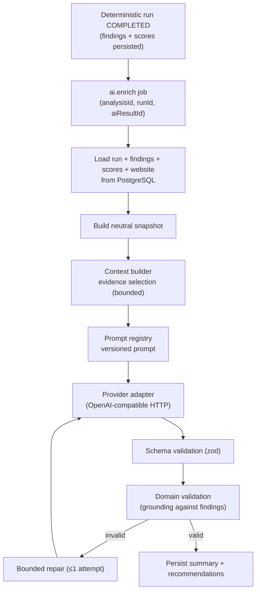

# AI Enrichment Flow

## Purpose

Describe the role of AI in the product — a **recommendation enrichment layer**
that explains and prioritizes deterministic findings — and how its output is
kept faithful to those findings.

## Scope

The `@analyzer/ai` package and the worker's AI execution path: input context,
provider abstraction, validation, grounding and failure isolation. It
deliberately does not document prompt wording or model-specific settings, which
are implementation details that may change without affecting the architecture.

## What AI is, and is not

AI in this system is an interpretation layer. It is not a detector, not a
scorer, and not a source of truth.

| AI does | AI does not |
| --- | --- |
| Summarize a completed analysis in plain language | Fetch or analyze a website |
| Prioritize existing findings | Create, remove or edit findings |
| Produce actionable recommendations grounded in finding codes | Compute or change scores |
| Flag strengths and weaknesses present in the results | Invent problems, evidence or rule codes |

The deterministic analysis runs first and is persisted before AI is even
considered. AI reads that persisted result and produces an explanation of it.

## Flow

### Selected context

The model never receives a raw database dump or raw HTML. The context is built
from the persisted deterministic result only, and it is deliberately small:

- the website host and URL,
- the run's status, overall score, category scores and any failed categories,
- the engine and scoring versions,
- a bounded, deterministically ordered selection of findings.

Evidence is compacted: each finding contributes at most two short evidence
strings, with descriptions and evidence truncated to fixed lengths. Selection is
deterministic — findings are ordered by severity, then by score impact, then by
stable rule code — so the same result always produces the same context.

Internal identifiers, user and project ids, timestamps, cookies and session
data are never part of the context.

### Provider abstraction

The application depends on a single interface — `AIProvider` — whose
implementation is an OpenAI-compatible adapter that speaks to any
`POST /chat/completions` endpoint over plain HTTP. Because structured validation
happens downstream, the adapter stays endpoint-agnostic and no provider SDK type
or exception crosses the boundary. Swapping providers is a configuration change,
not an application change. Model, base URL, timeout and output limits all come
from configuration.

### Validation chain

Model output is accepted only after passing three gates:

1. **Schema validation.** Output must parse as JSON and satisfy the structured
   schema. Non-JSON or off-schema output is rejected.
2. **Domain validation.** Every recommendation must reference finding codes that
   actually exist in the run, with a matching category; unknown codes, category
   mismatches, duplicate recommendations and over-referencing are rejected.
3. **Grounding.** Because recommendations must cite real finding codes, the model
   cannot introduce a problem that the deterministic engine did not observe.

If validation fails, the orchestrator makes at most one bounded repair attempt
with the validation issues fed back. A second failure is final. Website-derived
text (titles, descriptions, evidence) is treated as untrusted data and never as
instructions; the system prompt forbids acting on embedded instructions.

### Failure isolation

The AI lifecycle is fully separate from the deterministic lifecycle:

- AI runs on its own queue with its own retry policy.
- A provider failure marks only the AI result `FAILED`; the `AnalysisRun` stays
  `COMPLETED`.
- Retryable provider errors (timeouts, rate limits, 5xx) retry with backoff;
  configuration and validation errors fail fast without retrying.
- If no API key is configured, AI jobs fail fast as a configuration error rather
  than retrying pointlessly.
- AI failures never roll back deterministic findings or scores, and reports fall
  back to a deterministic executive summary when no AI summary is available.

### Usage tracking

Each AI result records the provider, model, prompt and schema versions, token
counts, latency and an estimated cost for known models. This keeps AI spend
observable without storing any prompt content or raw website data.

## Future considerations

- Additional AI tasks (for example, per-finding explanations) slot into the same
  validation and grounding chain as new task types.
- Multi-provider routing would be a change to the provider adapter composition,
  leaving the orchestrator's contract intact.
- Cost controls could cap enrichment per user or per period using the usage data
  already recorded.

See [../decisions/ai-orchestration.md](../decisions/ai-orchestration.md) for the
reasoning behind these boundaries.
