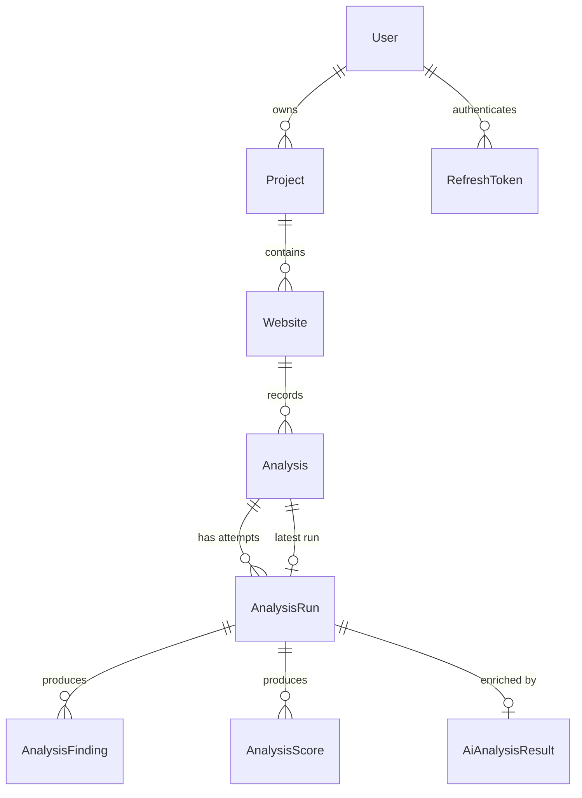
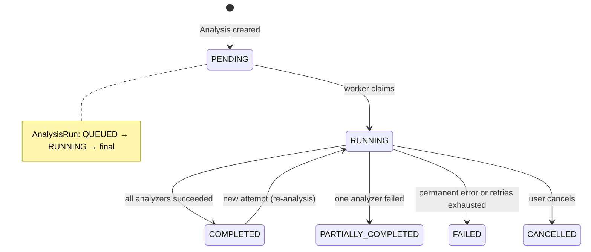

# Database Design

## Purpose

Document the persisted data model — entities, relationships, the ownership
chain, and the lifecycle of an analysis — so schema changes can be made without
breaking ownership guarantees or the deterministic/AI data contract.

## Scope

The PostgreSQL schema as expressed in Prisma (`apps/api/prisma/schema.prisma`)
and the index choices behind it. Query-level performance notes and the reasoning
behind SQLite-free, PostgreSQL-only storage live with the decisions documents.

## Entity-relationship diagram



## Entities

### User

The account. Holds a unique `email` and a `passwordHash` (Argon2). The hash is
never returned by the API. Deleting a user cascades to every owned resource.

### RefreshToken

A persisted refresh session. Stores a SHA-256 **hash** of the opaque token, never
the token itself; the raw token lives only in the `HttpOnly` cookie. Rotation
marks the previous row `revokedAt` rather than deleting it, so reuse can be
identified.

### Project

An ownership container owned by a user. Holds a name and optional description.
Indexed by `userId` because every project listing is user-scoped.

### Website

A monitored target belonging to a project. Stores both the raw `url` as entered
and a normalized form (`normalizedUrl`, `host`) used for identity. The
`(projectId, normalizedUrl)` uniqueness prevents the same target being registered
twice within a project.

### Analysis

The **user-facing history record**. One logical analysis maps to one or more
execution attempts. It carries a `status` and a nullable `latestRunId` pointing
at the most recent run, so the dashboard can read "the latest result" without
scanning all runs. Indexed by `(websiteId, createdAt)` for history and trend
queries.

### AnalysisRun

A single **execution attempt** of an analysis. The authoritative record of run
state:

| Field | Meaning |
| --- | --- |
| `status` | `QUEUED` → `RUNNING` → `COMPLETED` / `PARTIALLY_COMPLETED` / `FAILED` / `CANCELLED` |
| `attempt` | Number of times the run has been claimed |
| `engineVersion`, `scoringVersion` | Versions the result was produced with (reproducibility) |
| `startedAt`, `completedAt`, `failedAt`, `cancelledAt` | Lifecycle timestamps |
| `errorCode`, `errorMessage` | Classified failure information |
| `progress` | 0–100 coarse progress for polling |

Indexed by `(analysisId, createdAt)` for run listing and `(status, startedAt)` for
stale-run recovery.

### AnalysisFinding

One persisted finding: a stable `ruleCode`, its `category`, `severity`, title,
description, `scoreImpact` and structured `evidence` (JSON). The
`(analysisRunId, ruleCode)` uniqueness enforces one finding per rule per run and
serves as an idempotency backstop; `evidence` is JSON because evidence shapes
vary by rule but are always compact and bounded.

### AnalysisScore

A score snapshot: one row per category plus an `overall` row, with the weight
used. Persisting snapshots means the dashboard and reports read scores directly
instead of re-running scoring. `(analysisRunId, category)` is unique.

### AiAnalysisResult

The AI enrichment for a run, at most one per run (`analysisRunId` unique).
Records status, provider, model, prompt/schema versions, the structured summary
and recommendations as JSON, token usage, estimated cost, latency and any error.
Statuses are `PENDING`, `RUNNING`, `COMPLETED`, `FAILED`, `SKIPPED`. Its
lifecycle is deliberately independent of the run: `AnalysisRun = COMPLETED` with
`AiAnalysisResult = FAILED` is a normal, expected state. Indexed by
`(status, updatedAt)` for stale-AI recovery.

## Ownership model

Ownership is a strict chain, and every read or write is scoped to the
authenticated user at the top of it:

```text
User
 └── Project
      └── Website
           └── Analysis
                └── AnalysisRun
                     ├── AnalysisFinding
                     └── AnalysisScore
                     └── AiAnalysisResult
```

Consequences:

- Foreign identifiers resolve to **`404`, never `403`**, so resource
  enumeration is not possible.
- Cascading deletes keep the chain consistent: removing a user removes
  everything they own.
- The comparison and report features derive their inputs from this same chain;
  they persist nothing new and enforce the same ownership on every request.

## Analysis lifecycle



- Creating an analysis writes `Analysis` (PENDING) and an `AnalysisRun` (QUEUED)
  in one transaction.
- The worker claims the run, moving both to RUNNING.
- Success finalizes both; a single analyzer failure yields
  `PARTIALLY_COMPLETED` for the run while the analysis is still usable.
- Failures are classified; transient ones return the run to QUEUED for retry and
  permanent ones finalize as FAILED.
- A crashed run is recovered as failed after a staleness threshold.

The AI result has its own parallel lifecycle and never gates the deterministic
one.

## Index rationale

Indexes exist only where a real query pattern needs them:

| Index | Supports |
| --- | --- |
| `Project.userId` | Listing a user's projects. |
| `Website (projectId, normalizedUrl)` unique | Deduplicating targets within a project; project-scoped listing. |
| `Analysis (websiteId, createdAt)` | Website analysis history and trend series. |
| `AnalysisRun (analysisId, createdAt)` | Listing a run's attempts. |
| `AnalysisRun (status, startedAt)` | Stale-run recovery sweeps. |
| `AnalysisFinding (analysisRunId, ruleCode)` unique | Per-run retrieval and duplicate prevention. |
| `AnalysisScore (analysisRunId, category)` unique | Reading scores per run. |
| `AiAnalysisResult (status, updatedAt)` | Stale-AI recovery. |
| `RefreshToken userId`, `tokenHash` unique | Session lookup and rotation. |

Indexes are added only when a query pattern justifies them; speculative indexes
are avoided because they cost write throughput.

## Future considerations

- Multi-page crawls would add a page-scoped child under a run rather than
  changing these entities.
- Scheduled analyses would add a schedule entity referencing `Website`; the run
  model is already attempt-oriented and would not change.
- If dashboard reads ever outgrow the database, the projections are already
  isolated enough to cache behind a TTL without touching the authoritative
  tables.
