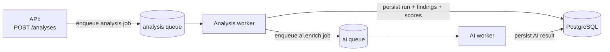
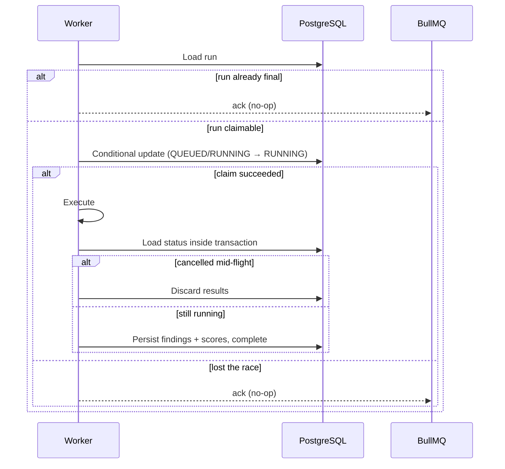

# Queue Architecture

## Purpose

Explain how asynchronous work is scheduled, executed, retried, made idempotent
and recovered, and why the queue is a transport for work rather than a store of
state.

## Scope

The two BullMQ queues (`analysis` and `ai`), their producers and consumers, and
the reliability semantics around them. The deterministic pipeline itself is
described in [analysis-pipeline.md](./analysis-pipeline.md).

## Queues

| Queue | Producer | Consumer | Concurrency | Job payload |
| --- | --- | --- | --- | --- |
| `analysis` | API | Worker (`AnalysisExecutionService`) | `WORKER_CONCURRENCY` (default 1) | `{ analysisId, runId }` |
| `ai` | Worker | Worker (`AIExecutionService`) | `AI_CONCURRENCY` (default 1) | `{ analysisId, runId, aiResultId }` |

Both run on the same Redis instance. They are separate queues because their
workloads are different: analysis jobs are bounded CPU/IO work whose concurrency
should stay low, while AI jobs are I/O-bound provider calls that can scale
independently and must never compete with analysis for slots.

### Lifecycle



Jobs carry **identity references only**. A job never transports a URL, raw HTML
or a result payload — the worker re-reads everything from PostgreSQL, which is
the single source of truth. This keeps jobs small, prevents stale data from
travelling through the queue, and means re-delivery is always safe.

## Execution semantics

### Claiming

The worker does not trust the queue to tell it that a run should execute. On
delivery it:

1. loads the run from PostgreSQL (missing rows are unrecoverable),
2. if the run is already final (`COMPLETED`, `PARTIALLY_COMPLETED`, `FAILED`,
   `CANCELLED`), returns immediately — a no-op,
3. otherwise performs a conditional update (a *claim*) that only succeeds from
   `QUEUED` or `RUNNING`, incrementing the attempt counter.

A claim that matches zero rows means another delivery won the race, so the job is
acknowledged without work. This pattern makes concurrent and duplicated
deliveries safe.

### Idempotency

Idempotency is enforced at three levels:

- **Deterministic job ids.** The AI job id is the AI result id, so the same
  enrichment can never be enqueued twice.
- **Uniqueness constraints.** `(analysisRunId, ruleCode)` and
  `(analysisRunId, category)` ensure duplicated writes cannot create duplicate
  findings or scores; persistence uses `skipDuplicates`.
- **Claim-and-check.** The run's status is re-read inside the finalization
  transaction, so a run cancelled mid-flight discards its results instead of
  overwriting the cancellation.

### Retry policy

Failures are classified into transient and permanent:

| Class | Examples | Behavior |
| --- | --- | --- |
| Transient | Connection timeouts, connection reset, DNS hiccups, HTTP 5xx, provider rate limiting | The run returns to `QUEUED` and BullMQ retries with exponential backoff, up to `ANALYSIS_JOB_ATTEMPTS` / `AI_JOB_ATTEMPTS`. |
| Permanent | SSRF blocks, invalid content type, invalid configuration, validation errors | Recorded with a stable error code and marked unrecoverable — BullMQ does not retry. |

When the final attempt fails, the run is marked `FAILED` and the error is thrown
as unrecoverable so the job is not retried further. Every transition logs the
run id, job id, queue, attempt, error code and duration.

### Cancellation

`POST /api/v1/analyses/:id/cancel` marks the analysis cancelled. A worker that is
mid-flight detects the cancellation when finalizing and discards its results, so
a cancelled run can never be completed by a late job.



## Stale-run recovery

A worker crash can leave a run stuck in `RUNNING` with no job to re-deliver. On
startup (and periodically, per `WORKER_STALE_CHECK_INTERVAL_MS`) the worker marks
any run whose `startedAt` is older than `WORKER_STALE_RUN_THRESHOLD_MS` as
`FAILED` with the `STALE_RUN_TIMEOUT` code. Stale AI results still in `RUNNING`
past the same threshold are marked failed with `AI_STALE_TIMEOUT`, never
touching the deterministic run.

Recovery deliberately **does not re-enqueue** the run. Re-enqueueing would allow
a single pathological job to re-queue itself indefinitely; instead the run is
surfaced for the user to retry explicitly. The recovery pass is a deliberately
simple startup-and-interval sweep (no distributed locking), which matches the
single-worker deployment model.

```mermaid
sequenceDiagram
    participant W as Worker (startup/interval)
    participant D as PostgreSQL
    W->>D: Find RUNNING runs with startedAt < threshold
    D-->>W: Stale runs
    loop each stale run
        W->>D: Mark run FAILED (STALE_RUN_TIMEOUT); mark analysis FAILED
    end
    W->>D: Find RUNNING AI results with updatedAt < threshold
    W->>D: Mark AI results FAILED (AI_STALE_TIMEOUT)
```

## Progress

The engine reports progress at coarse stage boundaries (fetch, parse, each
analyzer, completion). The worker writes the value to the run row, and the client
polls it. Progress is intentionally non-authoritative: a missed update never
affects correctness.

## Graceful shutdown

Both the API and the worker hook `SIGTERM` and close their BullMQ queues and
workers before exiting, so an in-flight job finishes or is safely re-deliverable
rather than being lost. The worker only begins consuming after asserting that
Redis and PostgreSQL are reachable, so a misconfigured process fails fast and
visibly instead of accepting jobs it cannot complete.

## AI queue isolation

The two queues are also a failure boundary. An AI failure never touches the
`AnalysisRun`:

```mermaid
sequenceDiagram
    participant AW as Analysis worker
    participant D as PostgreSQL
    participant IQ as ai queue
    participant IW as AI worker
    AW->>D: Persist deterministic result (COMMITTED)
    AW->>IQ: Enqueue ai.enrich (after commit)
    Note over AW: Enqueue failure marks only the AI result FAILED
    IQ->>IW: Deliver
    IW->>D: Claim AI result
    alt provider succeeds
        IW->>D: Persist summary + recommendations (COMPLETED)
    else provider fails
        IW->>D: AI result FAILED; deterministic run untouched
    end
```

`AnalysisRun = COMPLETED` with `AiAnalysisResult = FAILED` is an expected,
supported state. See [../decisions/queue-design.md](../decisions/queue-design.md)
for the reasoning behind these choices.

## Future considerations

- Recovery could become lock-aware if the worker is ever scaled horizontally;
  today's single-worker sweep is intentionally simpler.
- A scheduled-analysis capability would add a scheduler producer without
  changing the consumer contract.
- Job-level metrics could feed an external dashboard without altering the
  queues themselves.
