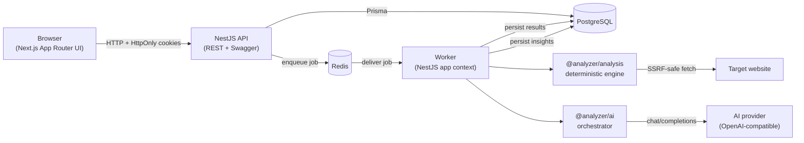
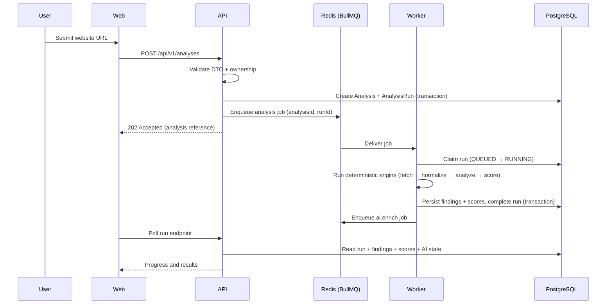

# System Overview

## Purpose

Give a single, accurate mental model of the running system: the components it is
made of, how a user request travels through them, and how a submitted website
becomes a scored, AI-enriched report.

## Scope

This document covers runtime components and their interactions. It does not
describe individual analyzers (see [analysis-pipeline.md](./analysis-pipeline.md)),
schema details (see [database-design.md](./database-design.md)) or the AI
validation chain (see [ai-enrichment-flow.md](./ai-enrichment-flow.md)).

## Components

The repository is a pnpm workspace with three applications and a set of
framework-independent packages.

### Applications

| Component | Technology | Responsibility |
| --- | --- | --- |
| **Web** (`apps/web`) | Next.js (App Router), React, Tailwind CSS | The dashboard. Renders projects, websites, analyses, trends, findings, comparison and report controls. Talks only to the API. |
| **API** (`apps/api`) | NestJS, REST, Swagger/OpenAPI | Authentication, resource ownership, validation, persistence, analysis creation/cancellation, dashboard projections and report endpoints. Serves `/health`. |
| **Worker** (`apps/worker`) | NestJS application context, BullMQ | Consumes analysis and AI jobs. Runs the deterministic engine and the AI orchestrator. Exposes no HTTP surface. |

### Infrastructure

| Component | Role |
| --- | --- |
| **PostgreSQL** | Authoritative store for users, projects, websites, analyses, runs, findings, scores, AI results and refresh tokens. |
| **Redis** | Backing store for BullMQ queues and for the API's distributed rate-limit counters. It carries work and counters, never authoritative state. |

### Framework-independent packages

| Package | Role |
| --- | --- |
| `@analyzer/shared` | Primitive utilities (URL handling, log levels, small helpers). No framework dependencies. |
| `@analyzer/contracts` | Typed request/response DTOs shared by the API and the web app, so the frontend never relies on `any`. |
| `@analyzer/config` | Centralized environment schemas with Zod validation and typed configuration loading. |
| `@analyzer/analysis` | The deterministic analysis engine: secure fetcher, HTML normalizer, analyzers, scoring, and run comparison. |
| `@analyzer/ai` | Provider-independent AI orchestration: context building, prompt registry, provider adapter, structured-output and grounding validation. |
| `@analyzer/report` | The professional report layer: a neutral `ReportDocument` model, a builder, and a server-side PDF renderer. |

### Component diagram



## Request flow

Every browser interaction follows the same shape:

```text
Browser
  → API (validate session cookie, validate DTO, enforce ownership)
  → PostgreSQL (read or write)
  → JSON response in the shared error/response envelope
```

Authentication is cookie-based: a short-lived JWT access token and an opaque
refresh token are both delivered as `HttpOnly` cookies. The API validates the
access token on every request and resolves the owning user; resource queries
are always scoped to that user. Slow or external work is not performed inline —
instead the API records intent and enqueues a job (see below).

A representative modal request: `POST /api/v1/analyses` creates an `Analysis`
and its first `AnalysisRun` in a single transaction, enqueues an analysis job,
and returns promptly. The client then polls the run endpoint for progress and
results. This keeps HTTP latency independent of how long a target website takes
to fetch and analyze.

## Processing flow

A submitted URL moves through the following stages:



The key properties of this flow:

1. **HTTP never blocks on analysis.** The request lifecycle ends at enqueue.
2. **Jobs carry identity, not payload.** A job carries `analysisId` and `runId`
   only; the worker loads everything else from PostgreSQL.
3. **The deterministic result is persisted before AI is considered.** AI
   enrichment runs as a *separate* job after the run is finalized, so a provider
   outage cannot affect the deterministic outcome.
4. **Progress is observable.** The run records a 0–100 `progress` value at
   coarse stage boundaries, which the client polls.

Details of the deterministic stages live in
[analysis-pipeline.md](./analysis-pipeline.md); the queue semantics and recovery
behavior live in [queue-architecture.md](./queue-architecture.md); the AI stage
lives in [ai-enrichment-flow.md](./ai-enrichment-flow.md).

## Failure boundaries

The system is designed so that a single failure degrades one capability rather
than the whole product:

| Failure | Effect |
| --- | --- |
| Target site unreachable / refuses the fetch | The run fails with a classified error; retries apply only to transient failures. |
| One analyzer throws | That analyzer's findings are dropped; the run is marked `PARTIALLY_COMPLETED` and the remaining analyzers' results are kept. |
| AI provider unavailable | The AI result is marked failed; the deterministic run stays `COMPLETED`. |
| Redis unavailable | Rate limiting degrades per a configured policy (auth always fails closed); the API stays up. |
| Worker crash mid-run | The run is recovered as failed after a staleness threshold. |

## Future considerations

- The API and worker share domain packages today; if load profiles diverge
  enough, the worker can be scaled independently without splitting the codebase.
- Read-heavy dashboard projections are candidates for caching should traffic
  justify it; the authoritative source remains PostgreSQL.
- The comparison and report layers were built as pure functions over existing
  models, so new report sections or comparison dimensions can be added without
  schema changes.
